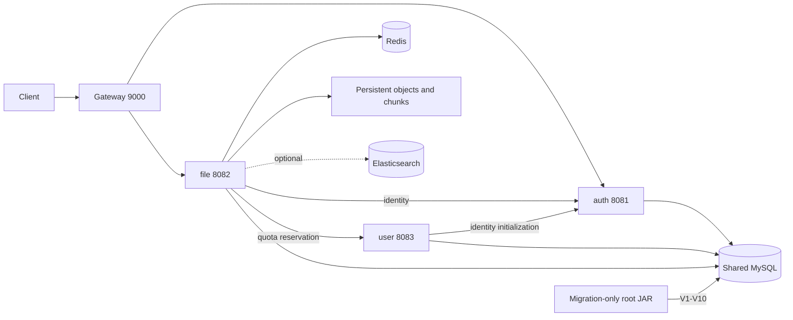

# Day29 Deployment And CI

## Scope

Day28 已验证 trace、指标、搜索降级与配额恢复。Day29 只将这些能力打包为可复现部署和临时依赖 CI，补齐接口/链路/故障证据与项目讲法；不增加业务语义、MQ、物理分库、AI 或聚合工程重构。



## Deployment Contract

- JDK17、PowerShell7、MySQL8；四个服务仍是独立 Maven 项目，根不是 aggregator。
- 根 migration JAR 不启动 Web、Redis 或业务 Bean；Flyway clean disabled，validate enabled。
- user-service 使用独立 history table，在根迁移后运行自己的 V1；数据库目前物理共享。
- dev 保留学习地址默认；ci 必须显式提供临时依赖；prod 外部传入 DB、密钥、URI 与绝对持久化目录。
- `Start-CloudDrive.ps1` 固定 loopback 和 8081/8083/8082/9000，拒绝已占用端口与历史8080写入口；关闭 Nacos。
- 持久化对象与分片目录互不嵌套，不能位于 build-output/target；Maven clean 不是数据清理工具。
- gateway prod 仅暴露 health/info；file metrics 仍要求单值内部令牌 GET，普通JWT不能读取。
- loopback 不是鉴权，也不是容器网络隔离。公网TLS、HA、进程监督、备份恢复未交付。

## Commands

依赖实例和schema账号必须先由运维创建。测试含fixture清理，只能使用新建隔离库，不运行于个人或真实业务库。环境值不写入命令历史或版本库；模板使用无引号单行 KEY=VALUE。

```powershell
# In the repository, after setting disposable DB/Redis process variables:
.\scripts\day29-ci.ps1 -MavenRepository C:\Environment\m2repo
.\scripts\day29-verify-jars.ps1

# Deployment: fill ignored deploy/.env with your instance settings first.
.\deploy\Import-CloudDriveEnv.ps1 -Path .\deploy\.env
.\deploy\Start-CloudDrive.ps1
.\deploy\Stop-CloudDrive.ps1 -RunDirectory '<directory returned by this deployment>'

# Serial runtime validation; stop a previous run before starting the next.
.\scripts\day29-packaged-smoke.ps1
.\scripts\day28-fault-drill.ps1 -PackagedJars
```

默认启动器先运行 `build-output/cloud-drive-learning-0.1.0-SNAPSHOT-migration.jar`，然后运行四个模块的 `build-output/*-0.1.0-SNAPSHOT.jar`。历史Web包虽然被审计，不参与本日部署。

中间件Compose只通过config静态验证。Nacos是显式可选profile；不宣称Docker容器或lb注册发现本轮已运行。停止应用只核对本次路径/PID/UTC ticks，不按全部java进程清理。

## CI Contract

`.github/workflows/day29-ci.yml` 使用 ubuntu-24.04、固定官方action提交、contents:read 与不持久化checkout凭据。每轮创建MySQL8.0/Redis7.2服务，不挂载个人目录或持久卷；动态端口传入runner。数据库密码是每轮公开测试值，JWT与内部令牌分别随机生成，不调用production secrets。

`day29-ci.ps1` 顺序运行根、auth、gateway、user、file的clean verify；任意非零阻断后续。CI默认不含ES，显式LiveSearch读取`CLOUDDRIVE_SEARCH_TEST_URI`。本机等价运行已通过，但Windows/native Redis3.0.504不等同Linux/Redis7.2；托管CI未触发。

`day29-secret-check.ps1` 仅针对当前源码数据库口令默认及tracked私有env；不是通用或历史密钥扫描。曾提交过的口令必须轮换，本日不重写历史或改变现有个人服务密码。

## Evidence And Tradeoffs

本轮220常规+5真实ES=225唯一JUnit；28配置合同、6个包、11重启存储及28故障断言分开计数。详见`docs/day29/runtime-evidence.md`与最终`acceptance.md`。

保留共享schema、同一schema账号的DDL权限、HS256签发能力共享、请求驱动配额恢复、对象与数据库非原子，以及ES/SQL语义差异与1000文档重建限制。没有生产压测、QPS/P99、备份恢复、自动部署或Linux运行结论。
