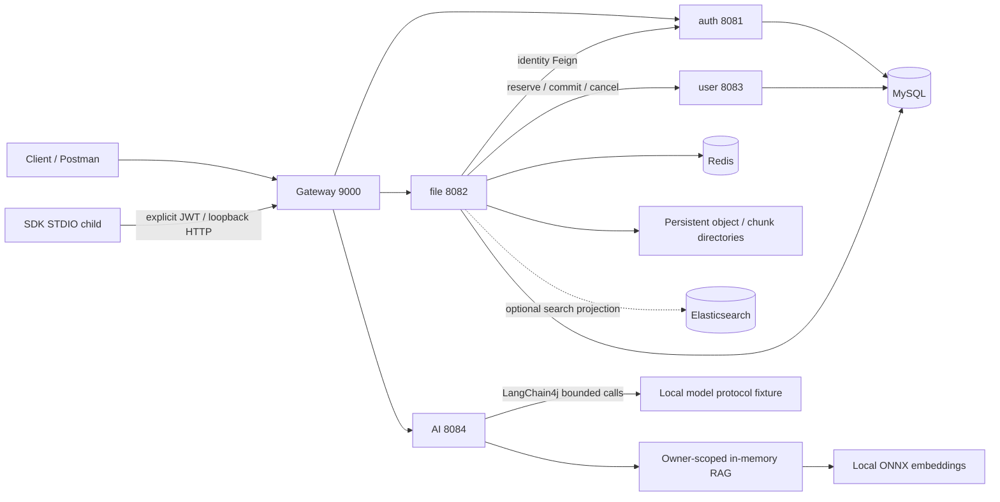

# Day34 Interview Evidence And Rehearsal

## 1 Evidence Boundary

This is an AI-assisted learning project, not a claim of independent implementation.
The candidate must replace draft wording with actions they actually performed.
Do not invent throughput, latency improvements, production users, cloud deployment, billing, or recordings.
JUnit counts are executed cases, not a coverage percentage or a performance benchmark.
The native Windows deployment is a reproducible equivalent environment, not Docker/Linux execution.
The model supplier remains DeepSeek + LangChain4j, but this rehearsal uses a local protocol fixture.
Real HTTP, JWT, MySQL, Redis, executable JARs, ONNX embeddings and MCP SDK are exercised.
No real DeepSeek request or semantic-quality evaluation is asserted.
The demo document's thirty-day statement is example content, not an audited product-retention policy.

## 2 Architecture

Logical data ownership is split, but the learning deployment still uses one physical MySQL schema.
MySQL and objects are authoritative; Redis and optional Elasticsearch are derived state.
No cross-service distributed transaction, MQ delivery guarantee, persistent RAG, or auto file ingestion is implied.
The historical monolith must not be a second writer during the multi-service demo.
The MCP surface exposes exactly two read-only tools, not upload/delete/shell/network-fetch capabilities.
Agent limits remain three model calls, two tool calls, one tool per turn, owner binding and citation validation.
A caller deadline and best-effort cancellation do not prove the remote model stopped computing.

## 3 Five-Minute Demonstration

| Time | Action | Evidence | State the boundary |
| --- | --- | --- | --- |
| 0:00-0:40 | Show architecture and deployment records | owned process receipts / health | native single host, no hosted CI claim |
| 0:40-1:20 | Register/login two users; spoof identity headers | real auth JWT; uploaded owner | JWT wins, raw header is not identity |
| 1:20-2:00 | Upload/download and Range | file ID / SHA256 / 206 Content-Range | checksum is integrity, not throughput |
| 2:00-2:40 | Restart business processes; download again | same file ID and raw-byte SHA256 | depends on persistent DB and object directories |
| 2:40-3:30 | Explicitly import downloaded text; ONNX search | RAG sourceSha256 / documentId | no automatic private-path reader |
| 3:30-4:10 | Agent answer; read citation; call MCP search | same documentId and exact quote | fixture output, not real model quality |
| 4:10-5:00 | Other-owner refusal; unlisted tool rejection; AI restart | 404 / NO_EVIDENCE / 502 / empty RAG | one failure case does not prove universal injection immunity |

Actual automated execution is recorded separately in runtime-evidence.md.
This timeline is a human rehearsal guide, not an assertion that a human recording exists.
Restart drill is a coordinated experiment; real restart durations are not compressed into a five-minute runtime claim.

## 4 Resume Draft

Possible heading: CloudDrive, Java backend learning project with controlled AI extension.

Draft after human verification:
- Implemented and explained owner-isolated file workflows using Spring Boot, MyBatis, MySQL and Redis; demonstrated upload/download, Range and restart persistence with executable artifacts.
- Analysed gateway JWT verification, service identity checks and request-driven quota compensation; used contract and integration tests to discuss remote uncertainty rather than claiming distributed exactly-once transactions.
- Explored owner-scoped RAG, local ONNX retrieval and bounded read-only Agent/MCP tools; validated protocol contracts and failure paths with local fixtures.

The verbs above are conditional drafts. If only AI implemented an item, use "studied and reproduced" only after actual reproduction.
Do not put the full automated test total beside "I independently wrote".
One honest, independently reproduced boundary is stronger than an unsupported list of technologies.

## 5 STAR: A Real Test Failure

Situation: Day33 executable-package smoke read Windows redirected AI logs as UTF-8.
Task: distinguish log-encoding failure from invalid HTTP payload or model protocol.
Action: inspect the native JVM default output encoding and preserve strict HTTP UTF-8 decoding; set the child JVM to -Dfile.encoding=UTF-8.
Result: the executable-package assertions could read logs; malformed HTTP UTF-8 remained rejected.
Evidence: Day33PackagedProbe.java and docs/day33/Final.md.
Limit: this fixes a demonstrated log-decoding path, not every Windows terminal encoding problem.
Human version must specify which diagnosis and reproduction the candidate personally performed.

Follow-ups:
1. Why not replace malformed bytes silently?
2. Which bytes are log output and which are protocol response content?
3. Which regression would show accidental weakening of the MCP boundary?

## 6 STAR: A Design Trade-Off

Situation: a file request crosses file-service and user-service quota ownership.
Task: avoid pretending a local database transaction covers remote HTTP.
Action: reserve/commit/cancel using an idempotent operation identifier, persist operation state and reconcile uncertain outcomes on later requests.
Result: explicit contract tests and fault drills make failure states observable.
Evidence: QuotaCoordinator / Day28DatabaseProbe / Day28 Final.
Limit: no XA/2PC, no MQ, no autonomous background reconciliation, no production scale claim.
Alternative: keep a monolith until ownership boundaries and deployment costs are justified.
Human exercise: draw the "response lost after commit" timeline before describing the implementation.

## 7 STAR: Observability And Rejection

Situation: an Agent could propose a forbidden tool after retrieving a hostile document.
Task: distinguish proposal, validated execution, provider attempts and complete-loop outcome.
Action: finite tool allowlist, strict argument schema, owner-bound search revision, exact citation validation and low-cardinality telemetry.
Result: the frozen Day33 fixture matrix checks HTTP status/code/model/tool tuples; Day34 repeats selected failures over the real gateway.
Evidence: AgentEvaluationHttpTest / AgentTelemetry / full-chain.json.
Limit: test fixtures do not estimate real prompt-injection prevalence or real-model accuracy; estimated cost is not an invoice.
Human exercise: explain why malformed requests rejected before service entry should not increment a service-span counter.

## 8 Why Not Pure CRUD Or Pure Agent?

CRUD establishes ownership, constraints, transaction boundaries, persistence and delivery contracts.
AI enriches a bounded document workflow but cannot authorize mutations or replace database truth.
A pure Agent would hide hard backend guarantees behind generated proposals.
A pure CRUD portfolio would miss retrieval provenance and controlled external-call concerns.
This project keeps both responsibilities separate and states exactly which part is mocked.
Do not claim the separation makes prompt injection impossible or establishes semantic entailment.

## 9 Mock Interview: 150 Minutes

| Minutes | Exercise | Scoring rule |
| --- | --- | --- |
| 0-10 | Select two already-practised algorithms | one must have an actual D+7 record; no fabricated history |
| 10-55 | Closed-book code one; orally derive another | invariants, complexity, boundary, counterexample |
| 55-80 | Java / SQL / Redis / network / Linux questions | every answer names a project file and a failure mode |
| 80-105 | Microservice / AI trade-offs | distinguish remote uncertainty, cache truth, fixture semantics |
| 105-125 | Five-minute demo plus pursuit questions | provide actual run artifacts; no scripts-only acceptance |
| 125-140 | Three STAR answers and resume review | only personal actions; no invented metrics |
| 140-150 | Error log and second-answer plan | record the original mistake before reading solutions |

Technical prompts:
1. What does a gateway route-table test fail to prove?
2. Why does file-service still verify the JWT or an explicitly enabled trusted gateway contract?
3. Why can a quota timeout not tell you whether the remote commit happened?
4. Which SQL predicate carries owner isolation, and which unique constraint handles active names?
5. Why is Redis not authoritative and Elasticsearch not a cross-service JOIN mechanism?
6. What does HTTP 206 promise? Does SHA256 establish access control?
7. What is the difference between a source quote, a relevant answer and semantic entailment?
8. How does MCP keep STDOUT clean, and why is a shutdown warning distinct from successful tool protocol?
9. Which metric labels must not contain user IDs, questions, run IDs or document IDs?
10. Which capability disappears after an AI restart and which must survive a business restart?

## 10 Human Gate Record

| Required record | Current status |
| --- | --- |
| Closed-book two-minute explanation | pending human evidence |
| Independent small replica; AI only reviews | pending human evidence |
| One original mistake, diagnosis, second answer | pending human evidence |
| Algorithm complexity / boundary / review date | pending human evidence |
| From-zero startup | pending human evidence |
| API collection executed by the candidate | pending human evidence |
| Key failure drill executed by the candidate | pending human evidence |
| Architecture drawing without notes | pending human evidence |
| Resume / STAR oral recording | pending human evidence |
| Suite C / D / E and D+7 history | pending human evidence |

No score, pass mark, recording file, personal contribution or "interview ready" label is filled by AI.
Day34 is the final planned engineering day; there is no invented Day35.
